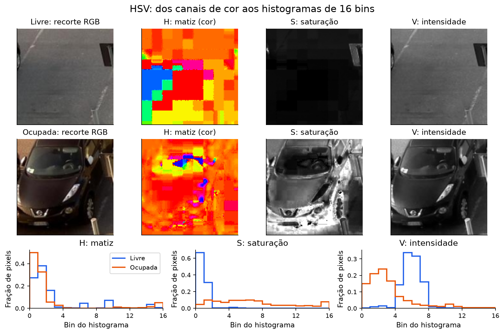
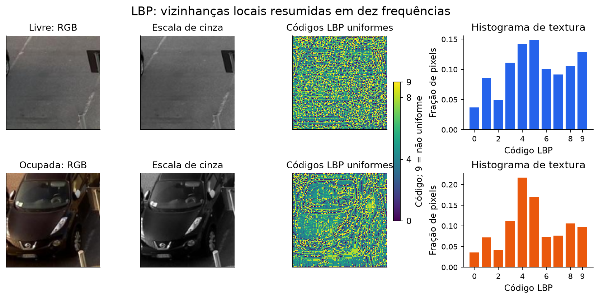
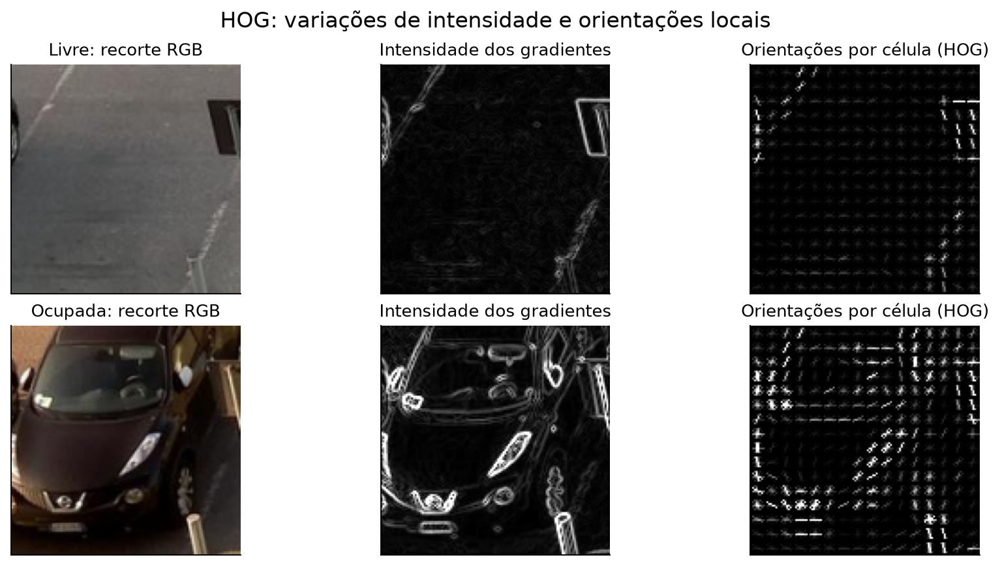
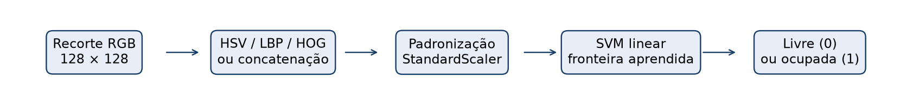

# Exemplos visuais dos descritores

As figuras abaixo usam dois recortes reais de **treino** da vaga 204, câmera 6, em 12/11/2015:
um às 07h46 (livre) e outro às 08h46 (ocupada). Os horários e a iluminação são diferentes;
o par serve para explicar as representações, sem estabelecer uma comparação causal.
Origem: [CNRPark+EXT / CNR-EXT](http://cnrpark.it/), licença ODbL 1.0.
Identificadores e hashes estão em [exemplos_metodos.json](imagens/exemplos_metodos.json).

## HSV: cor e distribuição de intensidades



H indica a matiz, S a saturação e V a intensidade. O mapa de H usa uma escala colorida;
nos mapas de S e V, pixels claros indicam valores altos. Em áreas quase cinzentas, de baixa
saturação, a matiz pode variar sem representar uma diferença de cor visualmente relevante.
O mapa colorido de H não é uma reconstrução da imagem original.

Os gráficos comparam as frequências dos 16 intervalos de cada canal. Cada histograma soma um;
o vetor usado pelo modelo é a concatenação dos três, com 48 componentes. Os histogramas vêm
da mesma função que extrai as características do experimento.

## LBP: textura local



Após converter a imagem para cinza, LBP compara cada pixel com oito vizinhos em um círculo
de raio um. O método uniforme resume os padrões em dez códigos: 0 a 8 para os padrões
uniformes e 9 para os demais. As cores identificam códigos; não representam carros ou asfalto.
O histograma conta a frequência de cada código e constitui o vetor de dez componentes.

## HOG: orientações de gradientes



O gradiente descreve mudanças de intensidade. O painel central mostra sua magnitude; o da
direita resume orientações em células 8 × 8. Os contornos da carroceria, dos vidros e dos
faróis introduzem estruturas que não aparecem na vaga livre.

O desenho de orientações é uma visualização por célula, não o vetor final. O descritor usado
pelo SVM inclui normalização em blocos 2 × 2 e possui 8.100 componentes. Os dois exemplos
usam a mesma escala de contraste; valores acima do percentil 99 do par são saturados apenas
na exibição. Os valores usados pelo classificador não são alterados.

## Da imagem à decisão



HSV, LBP e HOG produzem descrições numéricas. O StandardScaler padroniza os componentes
com estatísticas do treino; o SVM aprende a separar as duas classes nesse espaço. Na
combinação, os vetores HSV, LBP e HOG são concatenados antes da padronização.

## Reprodução das ilustrações

Com o dataset extraído e o manifesto disponível:

```powershell
.venv\Scripts\python -m visao_computacional.cli ilustracoes
.venv\Scripts\python -m visao_computacional.cli relatorio
```

Esses comandos não treinam modelos nem executam a avaliação. O par preferido foi inspecionado
visualmente; se ele não estiver em outro manifesto, o gerador procura uma vaga de treino com
as duas classes no mesmo dia. Os exemplos efetivamente utilizados ficam registrados no JSON.
