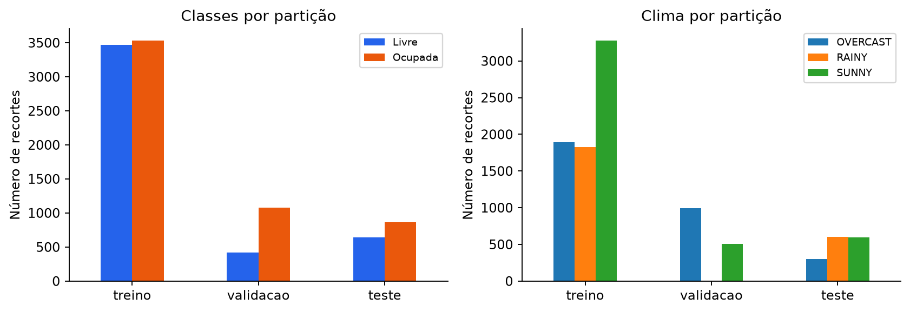
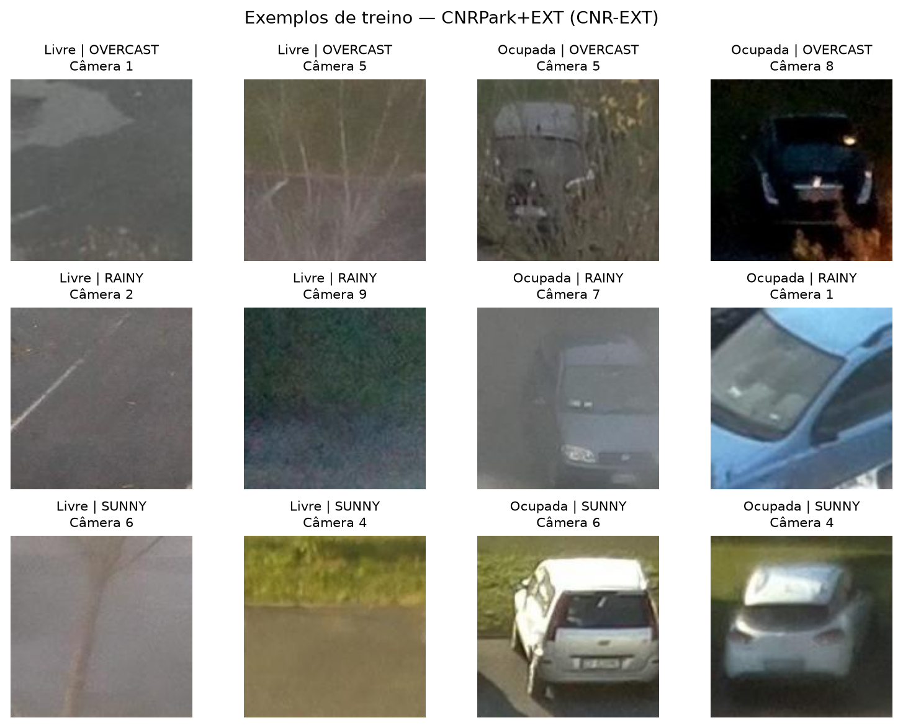
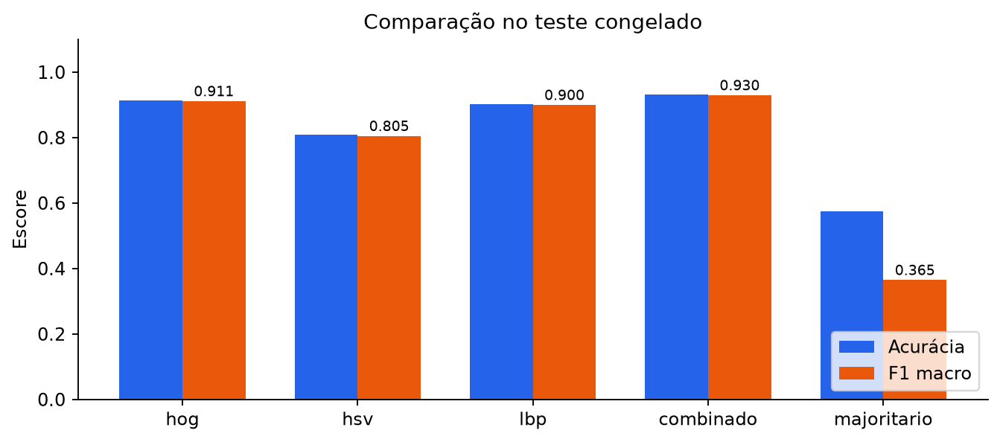
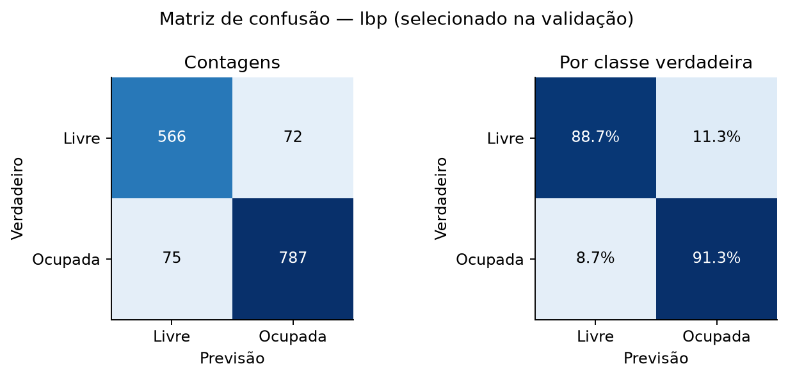
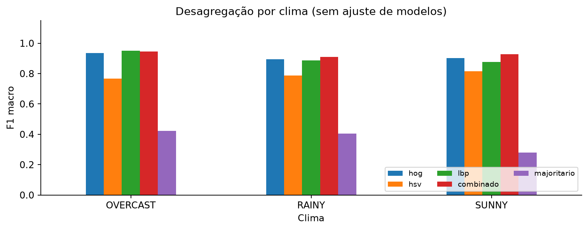
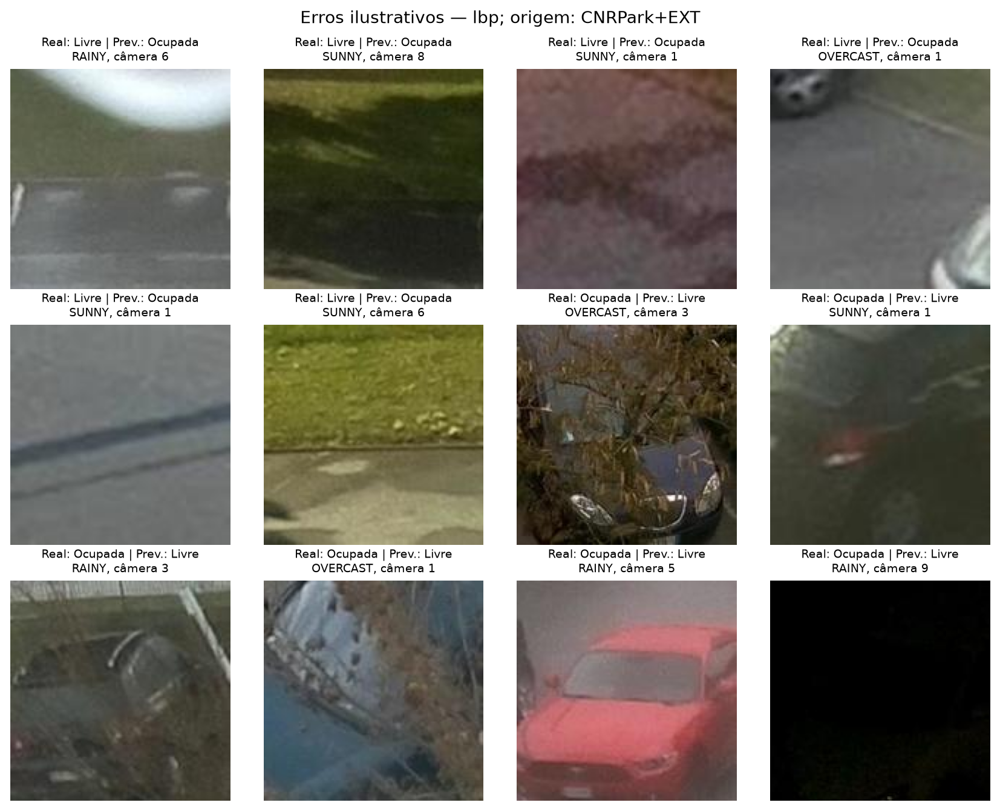

# Classificação de ocupação de vagas com métodos clássicos

T1 | INE5443 - Reconhecimento de Padrões | 2026-2

Repositório: Soul-Legend/VisaoComputacional

## 1. Resumo e objetivo

Este trabalho investiga a classificação binária de imagens individuais de vagas de estacionamento.
A entrada contém uma vaga previamente localizada; a saída indica livre (0) ou ocupada (1).
O objetivo é comparar descritores de cor, textura e gradientes, mantendo o classificador linear
e as partições de dados fixos. A pergunta experimental é: qual representação oferece o melhor
F1 macro de validação e como esse modelo se comporta em dias de teste distintos?

Foram utilizadas 10.000 imagens reais do CNR-EXT, selecionadas das listas oficiais dos autores
[1]. HSV, LBP, HOG e sua concatenação foram avaliados com SVM linear. O modelo selecionado
foi **lbp**, com C=0.01, F1 macro de validação **0.9028** e F1 macro de teste
**0.8998**. A acurácia de teste foi **0.9020**. A referência majoritária alcançou
F1 macro **0.3649**. Todos os valores são medições desta execução.

O problema é relevante porque a aparência de uma vaga varia com iluminação, clima, cor do
veículo, sombras e oclusões. O recorte adotado permite estudar essas variações sem depender
da localização automática de vagas. A tarefa de classificar uma região conhecida é diferente
de detectar veículos ou vagas em uma imagem completa; as conclusões ficam restritas à primeira.

### Contribuições

- Pipeline configurável com auditoria dos dados e identificação dos artefatos por hashes.
- Comparação de quatro representações e uma referência de classe majoritária.
- Seleção somente por validação, seguida de avaliação congelada e resultados por classe e clima.
- Análise ilustrativa dos erros e registro de custos computacionais.

Não há rede neural, vídeo, rastreamento, detector de vagas ou interface neste T1. O manifesto
e o teste serão preservados para a comparação posterior com uma abordagem neural no T2.
Uma boa pontuação neste estudo não comprova funcionamento em um estacionamento novo.

O desenvolvimento utiliza Python 3, OpenCV, scikit-image e scikit-learn. O código reutilizável
fica separado de documentação, resultados e relatório. As tabelas e figuras são geradas dos
artefatos registrados; dados brutos e modelos treinados não são incluídos no histórico Git.

<!-- PAGEBREAK -->

## 2. Fundamentação e justificativa

### Cor: histogramas HSV

HSV separa matiz, saturação e valor. Histogramas descrevem frequências de cores e reduzem a
dependência da posição exata dos pixels. Três histogramas com 16 bins são normalizados
individualmente e concatenados em 48 componentes. H usa o intervalo [0,180) do OpenCV;
S e V usam [0,256). A conversão de BGR para RGB é explícita na leitura das imagens.

A hipótese é que distribuições de cor de veículos e pavimento contenham informação útil.
Entretanto, histogramas globais descartam a organização espacial: recortes com objetos diferentes
podem produzir distribuições semelhantes. Sombras e iluminação também alteram os valores.

### Textura: Local Binary Patterns

LBP compara a intensidade de um pixel com a de seus vizinhos, codificando padrões locais
[3]. O operador uniforme com oito vizinhos e raio um produz um histograma de dez bins,
normalizado para soma um. A entrada é cinza inteiro, evitando comparações instáveis entre
valores de ponto flutuante. O histograma resume textura sem preservar sua localização.

A motivação é que asfalto, carrocerias, vidros e bordas gerem padrões diferentes. Um vetor
compacto permite verificar se essa informação basta para o problema. Adotar um único raio
é uma simplificação: não foi realizado estudo multiescala ou busca dos parâmetros do LBP.

### Forma: Histograms of Oriented Gradients

HOG agrega orientações de gradientes em células e normaliza blocos de células [2]. Foram usadas
nove orientações, células 8 × 8, blocos 2 × 2 e normalização L2-Hys. Em imagens de 128 × 128,
o vetor tem 8.100 componentes. A organização espacial aproximada dos contornos pode representar
estruturas introduzidas pelos veículos, embora também possa capturar o fundo e a perspectiva.

### SVM linear e combinação

SVM aprende uma fronteira de decisão no espaço das características [4]. C controla a penalização
de erros no treino. LinearSVC usa regularização L2 e perda quadrática hinge nesta implementação.
StandardScaler padroniza cada componente com estatísticas aprendidas somente no treino.

A concatenação HSV + LBP + HOG tem 8.158 componentes e testa a complementaridade das três
representações. A padronização é por componente, sem pesos explícitos para cada bloco.
Como HOG possui muito mais componentes, a comparação não esgota outras ponderações possíveis.
Não foram testados outros classificadores, kernels ou combinações parciais.

<!-- PAGEBREAK -->

## 3. Dataset, aquisição e auditoria

O CNRPark+EXT foi disponibilizado por Amato e colaboradores para classificação de ocupação
[1]. Utiliza-se apenas a extensão CNR-EXT: 144.965 recortes de nove câmeras, coletados em
23 dias, com condições SUNNY, OVERCAST e RAINY. O CNRPark original não foi incorporado.
As listas oficiais associam 0 a livre e 1 a ocupada e definem treino, validação e teste.

O arquivo foi adquirido da release dos autores. URL, tamanho e SHA-256 do download constam
na auditoria. A fonte indica licença ODbL 1.0. Os exemplos deste relatório são derivados
do CNRPark+EXT e mantêm a atribuição; o repositório não redistribui o arquivo bruto.

A auditoria encontrou **0 imagens ilegíveis**. Foram excluídos **38
registros com pixels idênticos e rótulos conflitantes**, antes de amostrar ou treinar.
Foram removidas **0 duplicatas adicionais**. A verificação usa hashes dos bytes
e dos pixels decodificados, incluindo dimensões. Havendo cópias sem conflito, a regra prevista
prioriza treino, validação e teste. A limpeza precede qualquer seleção de modelo.

| Partição | Livre | Ocupada | Total |
| --- | --- | --- | --- |
| treino | 3470 | 3530 | 7000 |
| validacao | 420 | 1080 | 1500 |
| teste | 638 | 862 | 1500 |

Tabela 1. Composição do subconjunto congelado.

Figura 1. Classes e clima por partição; cada barra representa contagem de imagens.

A amostragem usa cotas proporcionais por classe, câmera e clima dentro de cada partição,
com maiores restos e semente 42. Não se forçou balanceamento do teste. A proporção das
classes varia entre partições; por isso, a acurácia isolada não é suficiente para a análise.
O F1 macro atribui peso igual às duas classes na seleção.

<!-- PAGEBREAK -->

## 4. Exploração e independência das partições

Figura 2. Exemplos apenas de treino. Origem: CNRPark+EXT, subconjunto CNR-EXT.

Os exemplos permitem observar perspectiva, oclusão e iluminação sem consultar as predições
de teste. A auditoria também registra resoluções e distribuições por câmera, data e clima.
O redimensionamento para 128 × 128 mantém a dimensão constante dos descritores. Não foram
aplicadas transformações aleatórias ou aumento de dados.

Na amostra final, treino e teste compartilham **9 câmeras** e
**164 identificadores de vagas**. Há **0 datas** e
**0 capturas câmera/horário em comum** entre os dois conjuntos.
As contagens das demais combinações estão na auditoria versionada.

Essa estrutura avalia dias distintos do mesmo estacionamento. Mesmo sem duplicatas exatas,
o fundo e a geometria das vagas podem permanecer reconhecíveis. As imagens não constituem
observações totalmente independentes de vagas novas. Generalização para câmeras ou locais
inéditos exigiria outro protocolo, que está fora do escopo desta entrega.

<!-- PAGEBREAK -->

## 5. Protocolo experimental

### Treinamento e seleção

O manifesto contém identificador, caminho relativo, classe, câmera, data, horário, vaga, clima
e partição. Seu hash conecta os dados aos caches e modelos. Os arquivos locais são conferidos
com o hash auditado durante a extração, para detectar mudanças posteriores à limpeza.

Cada configuração foi ajustada somente nas 7.000 imagens de treino. StandardScaler aprende
média e desvio no treino e apenas transforma validação e teste. O SVM usa semente 42,
dual automático, tolerância 1e-4 e limite de 20.000 iterações. Não convergência interrompe
o treinamento, impedindo que um ajuste incompleto seja aceito silenciosamente.

São avaliados C = 0,01; 0,1; 1; 10 em cada representação. O maior F1 macro na validação,
arredondado a quatro casas, define o vencedor. Empates favorecem menor dimensão e depois
menor C. A mesma regra seleciona C por representação e o vencedor global. Não há retreino
com a validação. Os parâmetros dos descritores foram fixados antes dos experimentos.

### Congelamento e teste

O congelamento registra modelos, hashes, configuração e vencedor. A avaliação verifica esses
artefatos e abre um lote para todos os modelos. Um marcador impede repetir o teste no mesmo
estudo. As predições do teste não orientam hiperparâmetros, limiar ou escolha de representação.
O classificador majoritário aprende no treino a classe mais frequente e a prevê em todos os casos.

### Métricas

Acurácia é a fração correta. Precisão relaciona acertos às previsões de uma classe; recall
relaciona acertos aos exemplos reais daquela classe. F1 é a média harmônica de precisão e
recall, e F1 macro é a média dos F1 das duas classes. Os rótulos são fixos em [0,1], com zero
quando um denominador é nulo. Matrizes têm linhas verdadeiras e colunas previstas.

Os resultados por clima incluem tamanho e composição dos grupos. A pontuação de decisão do
SVM é exportada, mas não é uma probabilidade calibrada. Não se alterou o limiar padrão de decisão.

### Custos e rastreabilidade

A extração mede leitura, verificação de hash, redimensionamento e descrição. O treinamento
inclui o escalonamento. A inferência mede escalonamento e predição em lote, sem exportação
das pontuações ou figuras. Valores em ms/imagem são médias do lote, não latência em produção.
Não foram realizadas repetições para estimar variância de tempo ou intervalos de confiança.

O SHA-256 completo do manifesto está em auditoria.json e congelamento.json. Seus primeiros
32 caracteres são registrados na conclusão para permitir conferência da identidade experimental.

<!-- PAGEBREAK -->

## 6. Resultados de validação e teste

| Descritor | C | Dimensão | F1 macro | Ajuste (s) |
| --- | --- | --- | --- | --- |
| hog | 0.01 | 8100 | 0.8762 | 8.545 |
| hog | 0.1 | 8100 | 0.8741 | 9.476 |
| hog | 1 | 8100 | 0.8717 | 10.020 |
| hog | 10 | 8100 | 0.8717 | 10.547 |
| hsv | 0.01 | 48 | 0.7457 | 0.027 |
| hsv | 0.1 | 48 | 0.7463 | 0.028 |
| hsv | 1 | 48 | 0.7463 | 0.028 |
| hsv | 10 | 48 | 0.7463 | 0.028 |
| lbp | 0.01 | 10 | 0.9028 | 0.005 |
| lbp | 0.1 | 10 | 0.9021 | 0.006 |
| lbp | 1 | 10 | 0.9021 | 0.005 |
| lbp | 10 | 10 | 0.9028 | 0.005 |
| combinado | 0.01 | 8158 | 0.9027 | 5.952 |
| combinado | 0.1 | 8158 | 0.9003 | 5.978 |
| combinado | 1 | 8158 | 0.9003 | 4.823 |
| combinado | 10 | 8158 | 0.8995 | 6.108 |

Tabela 2. Todos os ajustes planejados. O tempo inclui escalonamento, mas não extração.

A seleção global escolheu **lbp**, C=0.01, com F1 macro **0.9028**.
Cada representação preserva seu melhor C de validação. Uma concatenação maior pode acrescentar
informação ou redundância; não se assumiu previamente que ela deveria vencer.

| Descritor | Acurácia | F1 macro | C |
| --- | --- | --- | --- |
| hog | 0.9127 | 0.9114 | 0.01 |
| hsv | 0.8080 | 0.8051 | 0.1 |
| lbp | 0.9020 | 0.8998 | 0.01 |
| combinado | 0.9307 | 0.9295 | 0.01 |
| majoritario | 0.5747 | 0.3649 | - |

Tabela 3. Mesmas 1.500 imagens para todos os modelos. O majoritário não tem descritor nem C.

O vencedor de validação atingiu F1 macro **0.8998** e acurácia **0.9020**.
A diferença de F1 macro em relação ao majoritário foi **0.5349**. No teste, combinado obteve o maior F1 macro. Isso não altera a seleção realizada pela validação.
O ranking do teste é descritivo e não autoriza alterar a seleção previamente congelada.

<!-- PAGEBREAK -->

## 7. Desempenho por classe e custo

Figura 3. Acurácia e F1 macro no teste. Diferenças não foram submetidas a teste de significância.

| Descritor | P livre | R livre | F1 livre | P ocup. | R ocup. | F1 ocup. |
| --- | --- | --- | --- | --- | --- | --- |
| hog | 0.870 | 0.934 | 0.901 | 0.948 | 0.897 | 0.922 |
| hsv | 0.758 | 0.806 | 0.781 | 0.849 | 0.810 | 0.829 |
| lbp | 0.883 | 0.887 | 0.885 | 0.916 | 0.913 | 0.915 |
| combinado | 0.897 | 0.945 | 0.921 | 0.958 | 0.920 | 0.938 |
| majoritario | 0.000 | 0.000 | 0.000 | 0.575 | 1.000 | 0.730 |

Tabela 4. P: precisão; R: recall. O suporte de cada classe está na Tabela 1.

Figura 4. Matriz do vencedor por validação, em contagens e percentuais por classe verdadeira.

O vencedor classificou **75 vagas ocupadas como livres** e **72
livres como ocupadas**. O primeiro erro pode encaminhar alguém a uma vaga indisponível;
o segundo pode ocultar uma oportunidade real. O recall da classe ocupada foi **0.9130**.
Não houve ajuste de limiar para privilegiar uma direção de erro.

<!-- PAGEBREAK -->

## 8. Custo computacional e condições climáticas

| Descritor | Dim. | Ajuste (s) | Extr. ms/img | Pred. ms/img |
| --- | --- | --- | --- | --- |
| hog | 8100 | 8.545 | 7.457 | 0.0239 |
| hsv | 48 | 0.028 | 1.147 | 0.0003 |
| lbp | 10 | 0.005 | 2.019 | 0.0002 |
| combinado | 8158 | 5.952 | 6.436 | 0.0198 |
| majoritario | 0 | 0.000 | 0.000 | 0.0001 |

Tabela 5. O ajuste refere-se ao melhor C de cada representação, não ao custo total da busca.
O majoritário não exige extração. A extração da combinação recalcula os três descritores;
o experimento não usa concatenação gratuita de caches para medir esse custo.

Tempos dependem de hardware, cache, carga e tamanho do lote. O escalonamento está incluído
na predição; aquisição, auditoria, gravação de caches, métricas e figuras ficam fora dela.
Uma comparação em tempo real precisaria medir o fluxo completo no equipamento alvo.

| Clima | N | Livre | Ocup. | hog | hsv | lbp | combinado | majoritario |
| --- | --- | --- | --- | --- | --- | --- | --- | --- |
| OVERCAST | 301 | 81 | 220 | 0.935 | 0.767 | 0.951 | 0.947 | 0.422 |
| RAINY | 606 | 194 | 412 | 0.894 | 0.786 | 0.886 | 0.909 | 0.405 |
| SUNNY | 593 | 363 | 230 | 0.901 | 0.816 | 0.876 | 0.928 | 0.279 |

Tabela 6. F1 macro por clima, com tamanho e composição dos grupos.

Figura 5. Desagregação do teste por clima, sem treinamento ou ajuste específico por condição.

Para o vencedor, o menor F1 macro por clima ocorreu em **SUNNY (F1 macro 0.8759, n=593)**. Essa diferença
é observacional: clima está associado a datas, iluminação e composição das cenas. Grupos
menores e desbalanceados são mais sensíveis a poucos erros. Não há demonstração causal
de efeito da chuva, nem avaliação de uma condição climática ausente do treinamento.

<!-- PAGEBREAK -->

## 9. Análise qualitativa dos erros

Figura 6. Até seis exemplos de cada direção de erro, amostrados com semente 42.
Origem: CNRPark+EXT. Identificadores e predições estão em erros_selecionados.csv.

A inspeção do painel mostra situações diferentes. Nos erros de livre para ocupada, aparecem
faixas de sombra, marcações e regiões de grama misturadas ao pavimento. No exemplo SUNNY da
câmera 6, a grama ocupa grande parte do recorte; na câmera 8, há uma sombra extensa. O
histograma LBP global resume todas essas texturas e descarta sua localização.

Nos erros de ocupada para livre, o exemplo OVERCAST da câmera 3 e o RAINY da câmera 3
apresentam vegetação sobre o veículo. Na câmera 1, há um veículo escuro sob sombra e outro
parcialmente encoberto por elementos da cena. A última imagem, RAINY da câmera 9, é quase
preta; a ocupação não pode ser confirmada visualmente a partir desse recorte. Conservou-se
o rótulo oficial, sem reinterpretá-lo depois de ver a previsão.

O veículo vermelho, RAINY da câmera 5, permanece reconhecível e ainda assim foi previsto
como livre. Portanto, os erros não se limitam a imagens impossíveis de interpretar. Essas
observações são hipóteses sobre limitações da representação, não demonstrações causais;
confirmá-las exigiria contexto das imagens completas e uma análise controlada.

Os exemplos foram escolhidos entre erros para interpretação, não para estimar frequência de
causas. Um painel de até 12 casos não constitui uma auditoria semântica completa do teste.
As observações não foram usadas para ajustar C, representação ou teste desta execução.

<!-- PAGEBREAK -->

## 10. Discussão, conclusão e reprodução

A configuração **lbp com C=0.01** foi selecionada pelo protocolo predefinido e
alcançou **0.8998 de F1 macro**. A diferença para a referência majoritária foi
**0.5349**. No teste, combinado obteve o maior F1 macro. Isso não altera a seleção realizada pela validação. O estudo compara configurações concretas de descritores;
não identifica o melhor método possível para todo cenário de estacionamento.

A comparação mantém dados, resolução, classificador e regra de seleção constantes, mas as
representações diferem em dimensão, custo e informação. Não foram estudados outros kernels,
ponderações da concatenação ou parâmetros de HOG e LBP. Diferenças pequenas são descritivas,
sem alegação de superioridade estatística. Não há avaliação de rede neural nesta entrega.

As principais limitações são um único estacionamento, reutilização de câmeras e vagas,
uma amostragem, ausência de intervalos de confiança e apenas uma execução de tempo. Separar
os dias reduz correlações temporais imediatas, mas não elimina pistas do fundo. Não se pode
extrapolar as métricas para câmera, estacionamento ou fluxo operacional inéditos.

No T2, a comparação com uma CNN deverá manter manifesto, teste, classes e métricas. Novos
experimentos de generalização precisam de outro protocolo, sem ajustes repetidos neste teste.

### Reprodução

Código e comandos: README.md e docs/reproducao.md. Sistema: Windows-11-10.0.26200-SP0.
Processador informado pelo sistema: AMD64 Family 26 Model 68 Stepping 0, AuthenticAMD. Commit do treinamento: 2a2d3937a873;
commit da avaliação: b2de1ddb7641. O arquivo requirements-lock.txt registra o ambiente completo.

| Componente | Versão |
| --- | --- |
| numpy | 2.5.4 |
| pandas | 2.3.3 |
| opencv-python-headless | 4.14.0.94 |
| scikit-image | 0.26.0 |
| scikit-learn | 1.9.1 |
| matplotlib | 3.11.2 |
| PyYAML | 6.0.3 |

Identidade do manifesto (SHA-256):

`f7ac99e8b862efdf66d50f9eb641ad29540eda7213c0ce911334bc10765e58ad`

As listas preservam caminhos relativos, e os artefatos de proveniência registram configurações,
versões e hashes. Dados e modelos não são versionados; podem ser obtidos e treinados novamente.

<!-- PAGEBREAK -->

## Referências

[1] Amato, G.; Carrara, F.; Falchi, F.; Gennaro, C.; Meghini, C.; Vairo, C.
Deep learning for decentralized parking lot occupancy detection. Expert Systems with
Applications, 72, 327-334, 2017. DOI: 10.1016/j.eswa.2016.10.055.
Dataset: http://cnrpark.it/ . Código e arquivos oficiais: github.com/fabiocarrara/deep-parking.

[2] Dalal, N.; Triggs, B. Histograms of Oriented Gradients for Human Detection.
IEEE Conference on Computer Vision and Pattern Recognition, 2005.
DOI: 10.1109/CVPR.2005.177.

[3] Ojala, T.; Pietikäinen, M.; Mäenpää, T. Multiresolution Gray-Scale and Rotation
Invariant Texture Classification with Local Binary Patterns. IEEE Transactions on Pattern
Analysis and Machine Intelligence, 24(7), 971-987, 2002. DOI: 10.1109/TPAMI.2002.1017623.

[4] Cortes, C.; Vapnik, V. Support-vector networks. Machine Learning, 20, 273-297,
1995. DOI: 10.1007/BF00994018.

### Documentação das implementações

OpenCV: docs.opencv.org . scikit-image: scikit-image.org/docs/stable/api/skimage.feature.html .
scikit-learn: scikit-learn.org/stable/modules/generated/sklearn.svm.LinearSVC.html .
As versões efetivamente utilizadas constam da seção de reprodução e dos arquivos de proveniência.

### Localização das evidências

- data/manifests/t1.csv: identidade, rótulos e partições das 10.000 imagens do estudo original.
- resultados/t1/metricas/auditoria.json: aquisição, limpeza e sobreposições.
- resultados/t1/metricas/validacao.csv: todos os ajustes e critérios de seleção.
- resultados/t1/metricas/congelamento.json: vencedor, modelos e hashes.
- resultados/t1/metricas/teste.csv: métricas e custos finais.
- resultados/t1/metricas/clima.csv: métricas e suportes por condição.
- resultados/t1/predicoes/: previsões individuais dos cinco modelos.
- resultados/t1/figuras/: imagens reproduzidas neste relatório.

O arquivo referencias.bib acompanha a fonte Markdown para permitir migração a outro modelo
de relatório sem redigitar os dados bibliográficos. A paginação e as figuras do PDF devem
ser conferidas sempre que o texto ou os resultados forem atualizados.
